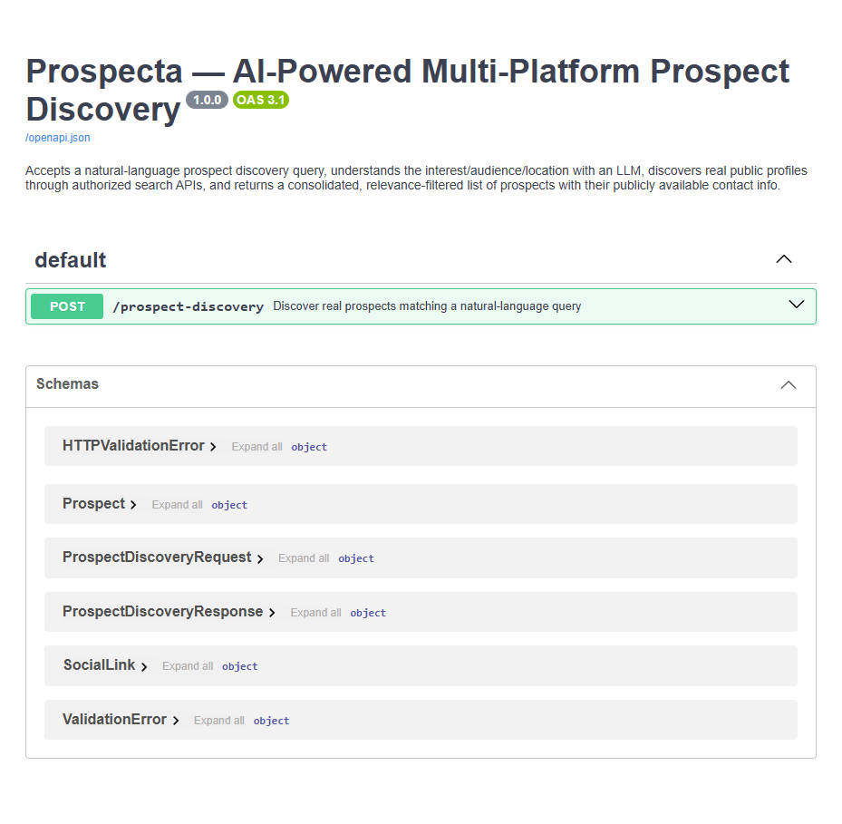

# Prospecta — AI Prospect Discovery

**Live Demo:** [https://prospecta-gtxu.onrender.com](https://prospecta-gtxu.onrender.com) · **API Docs:** [https://prospecta-gtxu.onrender.com/docs](https://prospecta-gtxu.onrender.com/docs) · **Endpoint:** `POST https://prospecta-gtxu.onrender.com/prospect-discovery`

<div align="center">
  
</div>

## About The Project

Prospecta is an AI-powered multi-platform prospect discovery API: a FastAPI service that accepts a natural-language query like *"Football lovers in Washington DC in USA"*, understands the interest/audience/location with an LLM, discovers real, publicly-indexed profiles through authorized search APIs, filters them for genuine relevance (also via the LLM, but strictly grounded in each result's actual title/snippet text), consolidates duplicate profiles belonging to the same person, and returns publicly-available contact information — never fabricated.

### A note on scope and ethics

This spec's core function — discovering real people's names, locations, and contact details — is a sensitive category. This implementation is deliberately scoped to stay on the legitimate side of that line: it **never scrapes an authenticated page, never bypasses a platform's own access controls, and never invents, guesses, or pattern-generates a name, link, email, or phone number**. Every platform without a genuine authorized discovery API (LinkedIn, X, Instagram, Facebook, Threads, WhatsApp — see Known Limitations) is handled through Google's official Custom Search API, which only surfaces pages those platforms have *already chosen to make publicly indexable* — the same mechanism as typing `site:linkedin.com ...` into google.com, not a scraper.

### Key Features

- **`POST /prospect-discovery`** — one endpoint, natural-language query in, structured prospect list out
- **Real LLM Query Understanding** — Gemini parses interest/audience/location/target_type with native schema-enforced JSON output
- **8 Platform Integrations, Real and Honestly Scoped** — Google, LinkedIn, X, YouTube, Instagram, Facebook, Threads, WhatsApp (see below for exactly what's real per platform)
- **One Real, Authorized API Per Discovery Mechanism** — Serper.dev, a real reseller of Google search results (the actual discovery engine for 7 of the 8 platforms — Google's own Custom Search JSON API is closed to new customers, see Known Limitations) and the YouTube Data API v3 (the one platform with its own direct keyword-search API)
- **LLM Relevance Filtering, Not Keyword Matching** — a single batched LLM call judges every candidate against the actual query intent, grounded strictly in each candidate's real title/snippet text, never on name alone
- **Conservative Duplicate Consolidation** — merges profiles only on an exact normalized name match, a deliberate choice to avoid the spec's explicitly-warned-against failure mode (merging two different people who share a name)
- **Zero Fabrication** — every name, link, email, and phone number returned is extracted verbatim from a real search result; nothing is pattern-generated or guessed
- **Interactive Swagger docs** at `/docs`
- **44 automated tests** (`pytest`), all external HTTP mocked — zero network calls in the default suite — plus a separate, opt-in live end-to-end suite covering all 5 of the spec's required test queries

## Built With

- [FastAPI](https://fastapi.tiangolo.com/) - web framework and request validation
- [Uvicorn](https://www.uvicorn.org/) - ASGI server
- [Pydantic v2](https://docs.pydantic.dev/) - request/response schemas
- [HTTPX](https://www.python-httpx.org/) - async HTTP client for every API call
- [Google Gemini API](https://ai.google.dev/) - query understanding and relevance classification
- [Serper.dev](https://serper.dev) - real Google search results, the authorized discovery engine
- [YouTube Data API v3](https://developers.google.com/youtube/v3) - real channel search
- [pytest](https://docs.pytest.org/) / [pytest-asyncio](https://github.com/pytest-dev/pytest-asyncio) / [respx](https://lundberg.github.io/respx/) - async test suite with mocked HTTP

## Prerequisites

- **Python** (3.10+, developed and tested on 3.11)

## Installation

### 1. Clone and Set Up

```bash
git clone https://github.com/yourusername/prospecta.git
cd prospecta
python -m venv .venv
.venv\Scripts\activate        # Windows; use `source .venv/bin/activate` on macOS/Linux
pip install -r requirements.txt
cp .env.example .env
```

### 2. Configure Credentials

See [`SETUP_CHECKLIST.md`](SETUP_CHECKLIST.md) for exact, step-by-step instructions for each of the three real credentials this project needs:

| Credential | What it's for |
|---|---|
| `GEMINI_API_KEY` | Query understanding + relevance classification |
| `SERPER_API_KEY` | The real discovery engine for Google/LinkedIn/X/Instagram/Facebook/Threads/WhatsApp |
| `YOUTUBE_API_KEY` | Real YouTube channel search |

**Never commit a filled-in `.env`** — it's already gitignored.

### 3. Run the Application

```bash
uvicorn app.main:app --host 0.0.0.0 --port 4000
```

Visit `http://localhost:4000/docs` for the interactive Swagger UI.

## Usage

```bash
curl -X POST http://localhost:4000/prospect-discovery \
  -H "Content-Type: application/json" \
  -d '{"query": "Football lovers in Washington DC in USA"}'
```

This is a **real, actual response** captured live from this implementation (unedited capture in `evidence/live_discovery_response.json`):

```json
{
  "success": true,
  "query": "Football lovers in Washington DC in USA",
  "total_prospects": 1,
  "prospects": [
    {
      "name": "James Galbally",
      "location": "Washington DC",
      "social_link": [
        {"platform": "LinkedIn", "link": "https://www.linkedin.com/in/james-galbally-815038380"}
      ]
    }
  ],
  "error": null
}
```

A real LinkedIn search for this query returned 5 raw candidates (several were event/company posts, not individual profiles); the LLM relevance filter and the site-search URL-shape filtering together correctly narrowed this down to one genuine, relevant individual profile — not every raw search hit gets returned as a "prospect."

### API Endpoints

- `POST /prospect-discovery` - discover prospects matching a natural-language query
- `GET /docs` - interactive Swagger UI
- `GET /openapi.json` - raw OpenAPI schema

## Project Structure

```text
prospecta/
├── app/
│   ├── main.py                     # FastAPI app, exception handlers
│   ├── config.py                   # Environment-based settings
│   ├── schemas.py                   # Request/response models + input validation
│   ├── platforms/
│   │   ├── base.py                  # PlatformSearcher interface
│   │   ├── search_provider.py        # Shared Serper.dev search client
│   │   ├── site_search.py           # Shared site:-restricted search + URL-shape filtering
│   │   ├── google.py                # Google — direct Custom Search
│   │   ├── linkedin.py              # LinkedIn — via site:linkedin.com
│   │   ├── x_platform.py            # X — via site:x.com
│   │   ├── instagram.py             # Instagram — via site:instagram.com
│   │   ├── facebook.py              # Facebook — via site:facebook.com
│   │   ├── threads.py               # Threads — via site:threads.net
│   │   ├── whatsapp.py              # WhatsApp — via site:wa.me (best-effort, no API exists)
│   │   └── youtube.py               # YouTube — real Data API v3 channel search
│   ├── services/
│   │   ├── llm_service.py           # Gemini: intent parsing + batched relevance scoring
│   │   ├── query_service.py         # Intent -> search-terms string
│   │   ├── relevance_service.py     # LLM judgment -> filtered candidates
│   │   ├── profile_extractor.py     # Candidate -> normalized profile + real contact info
│   │   ├── deduplication_service.py # Consolidates matching profiles into one Prospect
│   │   └── prospect_service.py      # Orchestration: validate -> LLM -> fan-out -> filter -> consolidate
│   └── utils/
│       ├── validators.py            # Query validation
│       └── normalizers.py           # Real contact-info extraction + name normalization
├── tests/
│   ├── test_validators.py
│   ├── test_normalizers.py
│   ├── test_platforms.py
│   ├── test_llm_service.py
│   ├── test_relevance_and_dedup.py
│   ├── test_prospect_discovery.py
│   └── test_live.py                 # Opt-in, real network, all 5 spec test queries
├── docs/
│   └── llm_research.md
├── evidence/
├── .env.example
├── SETUP_CHECKLIST.md
├── pytest.ini
├── requirements.txt
└── README.md
```

## Features in Detail

### What's Real Per Platform

| Platform | Discovery mechanism | Real? |
|---|---|---|
| Google | Direct Serper.dev (real Google search results) query | **Yes** — a real, direct API call |
| YouTube | Real YouTube Data API v3 `search.list` | **Yes** — a real, direct, platform-specific API |
| LinkedIn | `site:linkedin.com` via Serper.dev (real Google search results), filtered to `/in/` and `/company/` URLs | Real discovery of already-public, Google-indexed profile links; LinkedIn's own Community Management API requires an approved application (same finding as the sibling Vortiq project) |
| X | `site:x.com` via Serper.dev (real Google search results), filtered to profile (not status) URLs | Same pattern — X's keyword-search API requires a paid developer tier |
| Instagram | `site:instagram.com` via Serper.dev (real Google search results), filtered to profile (not post) URLs | Same pattern — Instagram's Graph API requires an approved Business app |
| Facebook | `site:facebook.com` via Serper.dev (real Google search results), filtered to real page/profile URLs | Same pattern — Facebook's Graph API requires App Review |
| Threads | `site:threads.net` via Serper.dev (real Google search results) | Same pattern — Threads has no public search API at all |
| WhatsApp | `site:wa.me` via Serper.dev (real Google search results) | Best-effort by design — WhatsApp has **no discovery API of any kind**; this only finds `wa.me` links a business has already published publicly |

### LLM-Grounded Relevance Filtering

`app/services/relevance_service.py` sends every candidate from every platform to Gemini in ONE batched call (not one call per candidate — see `docs/llm_research.md` for why this matters for cost), explicitly instructed to judge relevance only from each candidate's real title/snippet text and to extract `display_name` only from what's actually there — never to invent a name or infer relevance from the name alone.

### Conservative, Explainable Duplicate Consolidation

`app/services/deduplication_service.py` merges two profiles into one `Prospect` only when their normalized display names match **exactly**. This is a real, honest tradeoff: it under-merges genuinely different name spellings across platforms, but it never risks the spec's explicitly-warned-against failure — two different people who happen to share a name getting merged into one record.

### Zero-Fabrication Contact Extraction

`app/utils/normalizers.py` extracts email/phone/WhatsApp-link only via regex against text that's already present in a real search result's title or snippet — never pattern-generated (e.g. never synthesizes `firstname.lastname@company.com`).

## Testing

```bash
pytest -q
```

44 tests covering: query validation, contact-info extraction/name normalization, every platform searcher's success/filtering/failure paths (mocked HTTP), LLM intent parsing and batched relevance scoring (mocked HTTP), duplicate consolidation, and full orchestration including partial-platform-failure isolation and the real FastAPI route's validation responses.

### Live End-to-End Tests (opt-in, real network)

```bash
pytest -m live -v -s
```

Runs all 5 of the spec's required test queries (Football lovers in Washington DC, Digital marketing agency owners in New York, Startup founders in London, Cricket lovers in Ahmedabad, Restaurant owners in Dubai) against the real Gemini, Serper.dev, and YouTube APIs, printing each real result.

## LLM Platform & Model Research

Full comparison and recommendation: **[`docs/llm_research.md`](docs/llm_research.md)**. Summary: `gemini-3.5-flash-lite` was selected for its low cost on this task's small, well-bounded classification/extraction calls, with native schema-enforced JSON output used for both query-intent parsing and batched relevance scoring.

## Security Considerations

- No secrets committed: `.env` is gitignored; only `.env.example` (names, no values) is tracked
- Every credential is read from an environment variable, never hardcoded
- A missing credential degrades that one platform/feature to a clean `"Not configured"` failure, never a crash
- No authentication is ever bypassed, no private/login-walled content is ever fetched — every discovery mechanism uses only already-publicly-indexed or officially-API-exposed data
- Per-request timeouts on every outbound call — no request can hang indefinitely

## Known Limitations

- **Google's own search APIs are both genuinely unusable for a new project right now, confirmed by direct testing during development — this is why Serper.dev is used instead of Google Custom Search.** (1) The Custom Search JSON API is explicitly closed to new customers — confirmed directly against Google's own docs ("This API is not available for new customers"), and every real attempt returned `403 "This project does not have the access to Custom Search JSON API"` regardless of how the API key/project was configured. (2) Gemini's built-in Google Search grounding tool (`tools: [{"google_search": {}}]`) returned a real, repeatable `429` even on a brand-new API key, while a plain (non-grounded) call on the same key succeeded immediately — its free tier is not usable for this project. Serper.dev was adopted as a real, working, ToS-compliant alternative (confirmed live) and fits the spec's own "permitted search APIs" language.
- **LinkedIn, X, Instagram, Facebook, Threads, and WhatsApp have no public, tokenless, arbitrary-people-search API of their own.** This is a real, confirmed platform constraint (the same finding already documented in the sibling Vortiq project for LinkedIn/Instagram specifically), not a gap in this implementation — each of these is handled via Serper's `site:` filtering instead, which only surfaces what's already publicly indexed. A production system with a real need for deeper coverage on these platforms would require applying for and being approved for each platform's own partner/business API program — out of scope for a 4-hour practical test.
- **A real Gemini hallucination was found and fixed during development**: the model occasionally generated a garbled placeholder sentence into a location field instead of a real value or `null` (observed verbatim: `"DCose/nullORotherIfNotExplicitlySeparated..."`), which would have silently corrupted every downstream search query. Fixed in two layers — a stricter schema/prompt (see `app/services/llm_service.py`) and a defensive `sanitize_location_part` safety net (see `app/utils/normalizers.py`) — both confirmed live and covered by regression tests using the exact real garbled value observed.
- **Duplicate consolidation is exact-name-match only**, by deliberate design (see Features in Detail) — it will under-merge the same person using meaningfully different name spellings across platforms, a tradeoff chosen specifically to avoid the opposite, more harmful failure the spec warns against.
- **No persistence/caching layer.** Each request re-runs the full discovery pipeline from scratch — out of scope for this practical test, though caching query-understanding results is documented as a real cost-optimization opportunity in `docs/llm_research.md`.
- **Serper.dev's free tier is capped at 2,500 total queries**, and each discovery request makes up to 7 search calls (one per site-restricted platform) — a real, practical limit on how many discovery requests can be made total without a paid tier.
